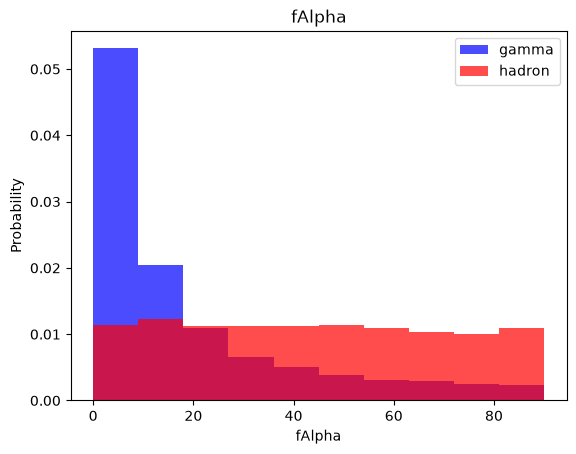
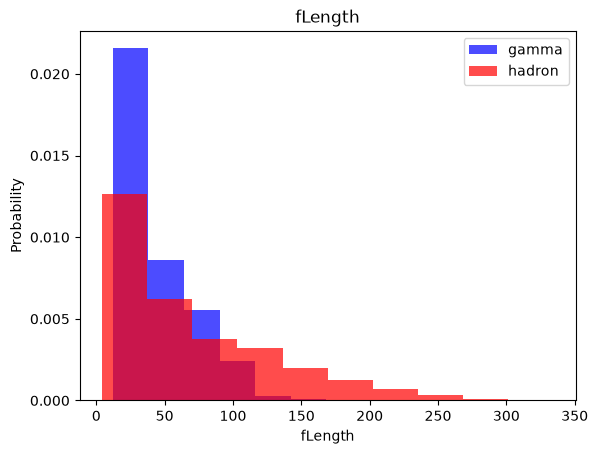

# Gamma-Ray Signal Classification Using Machine Learning

A Jupyter notebook that classifies events from the **MAGIC Gamma Telescope** dataset (UCI ML Repository) as gamma-ray signal or hadronic background, comparing four classical scikit-learn models with a small TensorFlow/Keras neural network.

The notebook follows the freeCodeCamp "Machine Learning for Everybody" MAGIC example, with the fixes listed under [Changes from the original notebook](#changes-from-the-original-notebook).

## Problem

Ground-based Cherenkov telescopes record the light from particle showers in the atmosphere. Showers started by high-energy gamma rays (signal) and showers started by cosmic-ray hadrons (background) leave differently shaped images in the camera. The task is to tell them apart from 10 image parameters (Hillas parameters) computed for each event.

## Dataset

Both files are included in the repository, so no download is needed.

| File | Contents |
|---|---|
| `magic04.data` | 19,020 rows, comma-separated, no header: 10 continuous features plus the class label (`g` / `h`) |
| `magic04.names` | UCI description of the dataset and its attributes |

- **Source:** [UCI ML Repository: MAGIC Gamma Telescope](https://archive.ics.uci.edu/dataset/159/magic+gamma+telescope) (Monte Carlo simulated events, donated by P. Savicky)
- **Features:** `fLength`, `fWidth`, `fSize`, `fConc`, `fConc1`, `fAsym`, `fM3Long`, `fM3Trans`, `fAlpha`, `fDist`
- **Classes:** gamma (signal) 12,332 rows, hadron (background) 6,688 rows

## Pipeline

```
magic04.data
  -> label encoding (g = 1, h = 0)
  -> per-feature histograms by class
  -> shuffle (seed 42), split 60% train / 20% validation / 20% test
  -> StandardScaler fitted on train, applied to all three splits
  -> RandomOverSampler on train only (balances gamma/hadron)
  -> kNN, Gaussian Naive Bayes, Logistic Regression, SVM (scikit-learn defaults, kNN k=5)
  -> neural network grid search, best model picked by validation loss
  -> classification_report on the test split
```

The neural network is two hidden ReLU layers with dropout and a sigmoid output, trained with Adam on binary cross-entropy for 100 epochs. The grid search covers 54 combinations: hidden units {16, 32, 64}, dropout {0, 0.2}, learning rate {0.01, 0.005, 0.001} and batch size {32, 64, 128}. It plots the loss and accuracy curves for every combination.

## Results

These are the test-split numbers from the outputs saved in the notebook. They were produced by running the whole notebook with `jupyter nbconvert --execute` on Python 3.11 with the library versions listed under [Requirements](#requirements), on CPU. The test split has 3,804 events (1,331 hadron, 2,473 gamma).

| Model | Accuracy | Macro F1 | Hadron recall | Gamma recall |
|---|---|---|---|---|
| k-Nearest Neighbors (k=5) | 0.81 | 0.79 | 0.74 | 0.84 |
| Gaussian Naive Bayes | 0.71 | 0.64 | 0.39 | 0.88 |
| Logistic Regression | 0.77 | 0.75 | 0.71 | 0.81 |
| Support Vector Machine (RBF) | 0.86 | 0.84 | 0.79 | 0.89 |
| Neural network (best of 54 by validation loss) | 0.87 | 0.86 | 0.80 | 0.91 |

The seed makes the split and oversampling deterministic. TensorFlow training on different hardware or library versions can still move the neural network figures slightly.

### Example output

Class-conditional histograms are drawn for each feature. `fAlpha` (the angle of the shower's major axis relative to the camera centre) is one of the clearest separators: gamma events cluster near zero.

<p>
  
  
</p>

## Requirements

- Python 3.10 or newer (last run on 3.11)
- The packages in `requirements.txt`. The saved outputs were produced with numpy 2.4, pandas 3.0, scikit-learn 1.9, imbalanced-learn 0.14, matplotlib 3.11 and tensorflow-cpu 2.21 (Keras 3).

## Getting started

```bash
git clone https://github.com/ShibilAhamed701212/Gamma-Ray-Signal-Classification-Using-Machine-Learning.git
cd Gamma-Ray-Signal-Classification-Using-Machine-Learning

python -m venv .venv
source .venv/bin/activate        # Windows: .venv\Scripts\activate
pip install -r requirements.txt

jupyter notebook Copy_of_fcc_MAGIC_example.ipynb
```

To execute the whole notebook from the command line instead:

```bash
jupyter nbconvert --to notebook --execute --inplace --ExecutePreprocessor.timeout=-1 Copy_of_fcc_MAGIC_example.ipynb
```

The neural network grid search is the slow part: 54 models at 100 epochs each took about an hour on a 4-core CPU. To try the notebook quickly, shorten the lists in the grid-search cell or lower `epochs`.

The notebook can also be opened in Google Colab (it was originally a Colab notebook); upload `magic04.data` to the session first.

## Project structure

```
.
├── Copy_of_fcc_MAGIC_example.ipynb   # the full analysis, with saved outputs
├── magic04.data                      # dataset
├── magic04.names                     # dataset description
├── images/                           # figures exported from the notebook outputs
├── requirements.txt
└── README.md
```

## Changes from the original notebook

| Issue | Effect | Fix |
|---|---|---|
| `np.split(df.sample(frac=1), ...)` returns NumPy arrays with current NumPy/pandas | The notebook crashed in `scale_dataset` with `AttributeError: 'numpy.ndarray' object has no attribute 'columns'` | Split with `DataFrame.iloc` slices |
| A new `StandardScaler` was fitted on each split separately | Validation and test data were scaled with their own statistics instead of the training statistics | Fit one scaler on the training split and apply it to all three |
| Keras `validation_split=0.2` on the oversampled training array | `RandomOverSampler` appends duplicated minority (hadron) rows at the end, so the "validation" curves were measured only on copies of hadron rows, and those rows were removed from training | Pass the real validation split with `validation_data=(X_valid, y_valid)` |
| No random seeds | Every run gave a different split and different results | One `SEED = 42` used for the shuffle, the oversampler and `tf.keras.utils.set_random_seed` |
| `input_shape=` on a `Dense` layer | Deprecated in Keras 3 (warning) | Use `tf.keras.Input(shape=...)` |
| Loss/accuracy plots had labels but no legend | Train and validation curves could not be told apart | Added `legend()` to both axes |

## Known limitations

- **Accuracy is not the metric the dataset authors recommend.** `magic04.names` notes that misclassifying a hadron as a gamma is worse than the reverse and suggests ROC-based measures at low false-positive rates. The notebook only reports `classification_report`.
- The classical models use scikit-learn defaults; only the neural network is tuned.
- The validation split is used both to monitor training curves and to pick the best network, so the test split is the only unbiased estimate.
- The grid search keeps every trained model's plot in the notebook, which makes the file large (about 4.6 MB).
- There are no automated tests or CI; the notebook is validated by executing it end to end.

## License

No license file is included in this repository. The MAGIC Gamma Telescope dataset comes from the UCI Machine Learning Repository and is distributed under CC BY 4.0. Citation: Bock, R. (2004). MAGIC Gamma Telescope. UCI Machine Learning Repository. https://doi.org/10.24432/C52C8B
